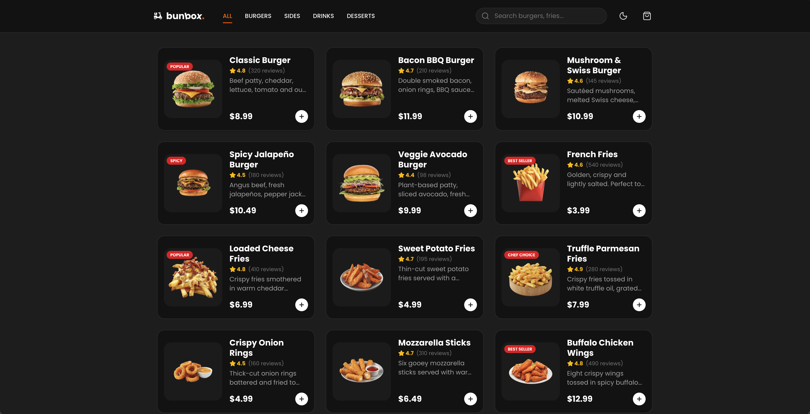

# Bunbox

A fast food online store with a working shopping cart, live search and dark mode.

[Live demo](https://bunbox-cart-sxc.vercel.app) · [Report a bug](https://github.com/softXcruz/Bunbox-Cart/issues)

## About

Bunbox is a front-end project I built to practice state management in a shop-style interface: a cart that survives a page reload, filters and search that respond as you type, and a theme that follows your preference.

## What it does

- Browse the menu and filter it by category.
- Search products as you type.
- Add items to the cart, change quantities and remove them. Totals update right away.
- The cart is saved in the browser, so it's still there after a refresh.
- Light and dark themes.
- Responsive layout for phones, tablets and desktop.

## Stack

- Next.js and React
- TypeScript
- Tailwind CSS
- Vercel for hosting

## Decisions worth mentioning

**The cart uses `useReducer`.** Adding, removing and changing quantities are all actions on one reducer instead of several `useState` calls that have to stay in sync. Every change to the cart goes through the same place, which makes the logic easy to follow and to test.

**The cart persists in `localStorage`.** It's restored when the app loads and saved when it changes. Anything read from storage is treated as untrusted and falls back to an empty cart if it's missing or malformed.

**Filtering and search work together.** The visible products come from the category and the search text at the same time, calculated from the same list, so the two never fall out of sync.

## Limitations

- It's a front-end demo. There is no checkout, payment or user accounts.
- The cart lives in one browser. It isn't shared between devices.

## Credits

Built by [Marco cruz (softxcruz)](https://github.com/softXcruz).
